

  

<h1 align="center">스륵뷰 · Sruk</h1>

<b>사진을 스륵스륵 · Glide through your photos.</b> 
가볍고 빠른 Windows 이미지 뷰어 · A light, fast image viewer for Windows

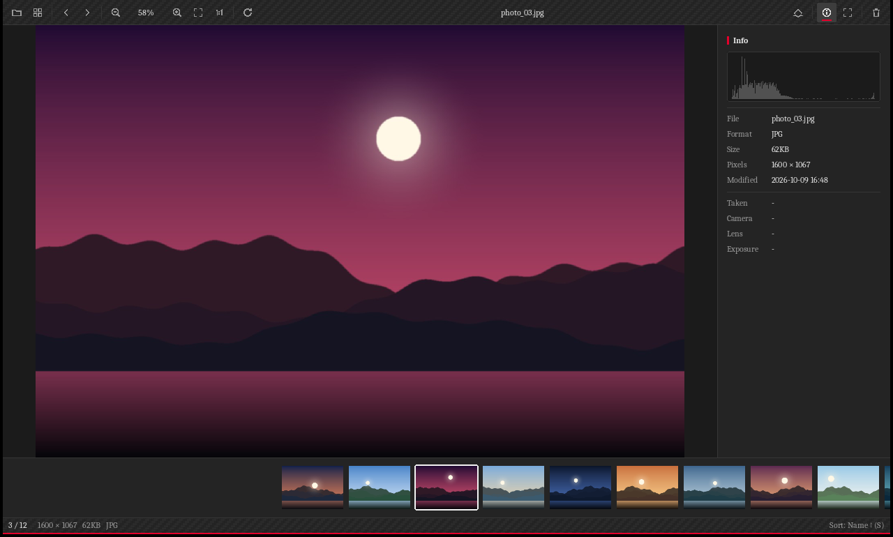

[한국어](#한국어) · [English](#english)

---

## 한국어

가볍고 빠르고 간편하게 쓸 수 있는 이미지 뷰어를 원해서 만들었습니다. 사진을 열고 넘기고, 고르는 일에 집중했습니다.

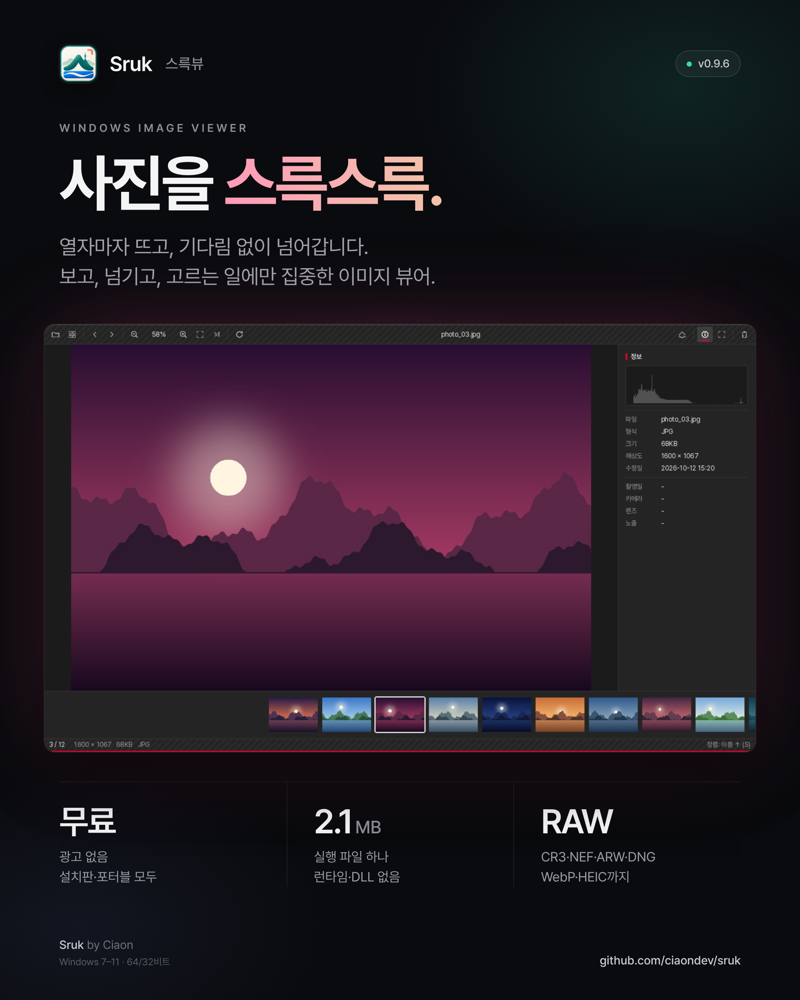 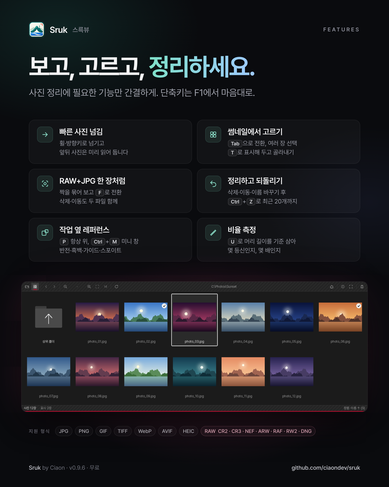

IrfanView와 같은 조건에서 잰 속도·메모리 자체 측정 결과는 [벤치마크 문서](benchmark/README.md)에 있습니다.

### 특징

- **설치 없음:** `sruk.exe` 하나(약 2.1MB, Windows 7 SP1·8·8.1·10·11, 64비트·32비트). 런타임·DLL 필요 없음.
- **빠른 넘기기:** Direct2D로 그리고, 앞뒤 사진을 미리 읽어 둡니다.
- **형식:** JPG, PNG, BMP, GIF·APNG(움직임 재생), TIFF, ICO, 카메라 RAW(CR2·CR3·NEF·ARW·RAF·RW2·DNG 등, LibRaw).
- **RAW+JPG 짝:** 같은 이름의 RAW와 JPG를 하나로 묶어 보고, F로 서로 전환합니다. 삭제·이동·복사도 함께.
- **고르기:** 썸네일에서 Ctrl·Shift·끌기로 여러 장 선택, T로 표시, Del(휴지통)·M(이동)·C(복사).
- **정보 패널:** 히스토그램, 파일 정보, 촬영 정보(카메라·렌즈·노출).
- **클립보드:** 이미지·파일·경로 복사(단축키 또는 오른쪽 클릭).
- **단축키 바꾸기:** F1에서 모든 단축키를 보고 기능마다 3개까지 바꿀 수 있습니다.
- **한국어 / English:** Windows 표시 언어를 따르고, 오른쪽 클릭 → 언어에서 바꿀 수 있습니다.
- **새 버전 알림:** 하루 한 번 GitHub 릴리스를 확인해 알려 주고, [받아서 설치]를 누르면 설치 파일을 받아 SHA-256을 확인한 뒤 설치 화면을 엽니다. 오른쪽 클릭 → 새 버전 자동 확인에서 끌 수 있습니다.

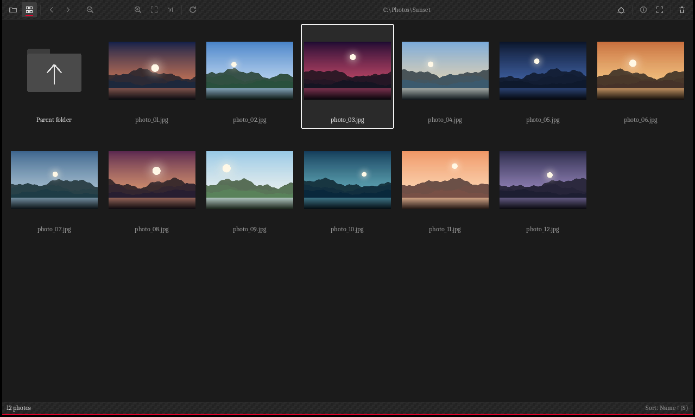 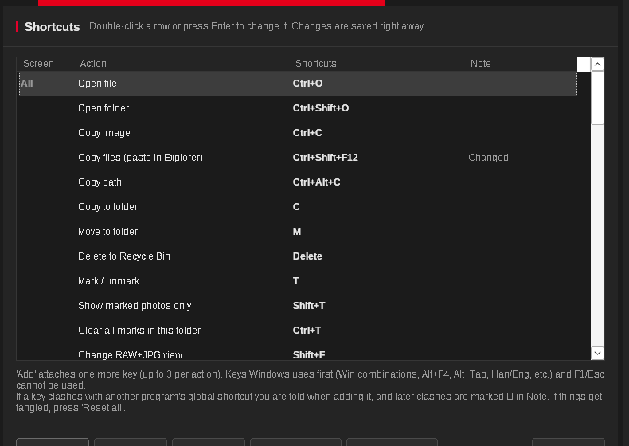

### 레퍼런스 보기·비율 측정 (조형·드로잉용)

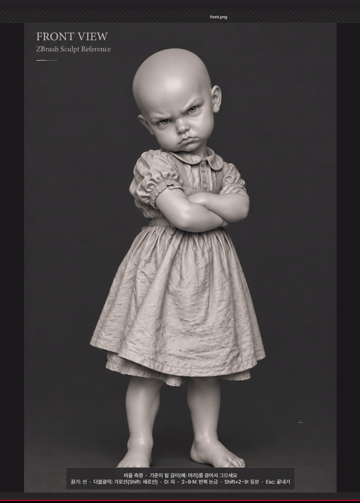 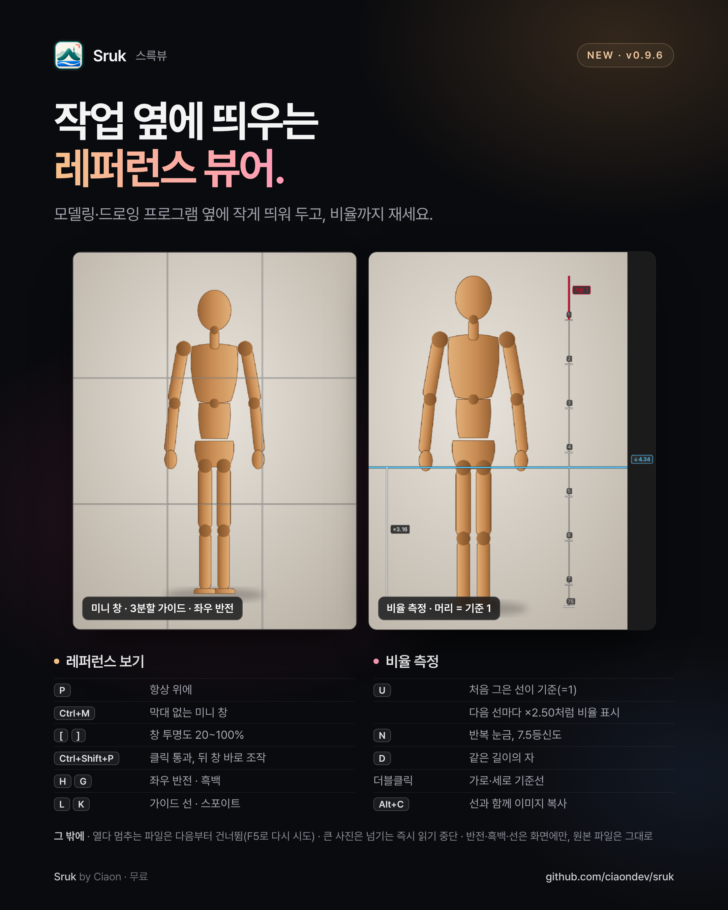

▶ **사용법 영상(2분):** https://youtu.be/KywplfJmm-U

- **비율 측정(U):** 정수리→턱으로 기준선을 그으면 그 길이가 1. 숫자 키로 머리 길이 눈금을 쌓아 몇 등신인지 보고(N으로 4.5 같은 소수), 다른 선은 기준의 몇 배인지 표시. 더블클릭 가로선으로 눈·코·입 높이, D로 같은 길이의 자, Shift+숫자로 등분. 선은 사진마다 저장되고 사진 폴더에는 아무것도 만들지 않습니다.
- **레퍼런스 보기:** H 좌우 반전, G 흑백, L 가이드(중심선·3분할·격자), K 스포이트(색 코드 복사), [ ] 투명도, P 항상 위, Ctrl+M 미니 창(사진을 끌어 옮김).

### 사진 고르기 (RAW+JPG)

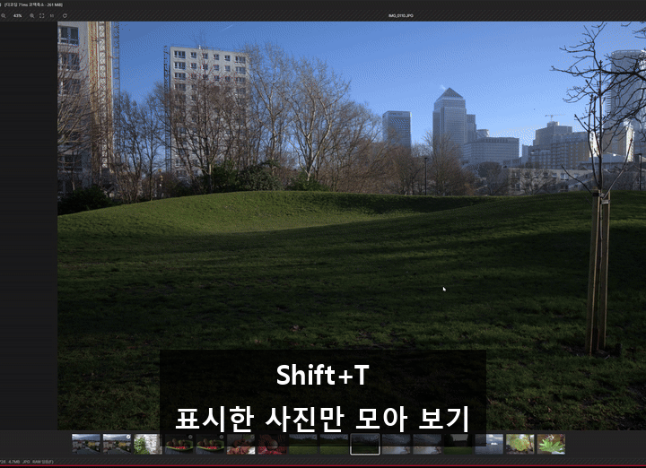

▶ **사진 고르기 영상:** https://youtu.be/PyW0EvnIPAw

- 같은 이름의 RAW와 JPG가 한 장으로 묶여 보입니다(F로 RAW/JPG 전환).
- I로 히스토그램과 촬영 정보(카메라·렌즈·노출)를 보며 고릅니다.
- T로 버릴 사진을 표시하고 Shift+T로 표시한 것만 모아 봅니다.
- Del 한 번이면 RAW와 JPG가 함께 휴지통으로 가고, Ctrl+Z로 한 번에 되살립니다.

짧은 영상(쇼츠): [몇 등신 재기](https://youtube.com/shorts/mkZ82t1-m-Y) · [얼굴 비율](https://youtube.com/shorts/LvnBxrhotoc) · [레퍼런스 단축키 4개](https://youtube.com/shorts/hjewRoDfB50) · [RAW+JPG 정리](https://youtube.com/shorts/Jrp2fy-PTb4) · 영상 목록과 원본 파일은 [media](media/README.md)

### 내려받기

[Releases](../../releases)에서 **`Sruk-Setup-<버전>.exe`** 를 받아 실행하면 바로 설치됩니다.
- 관리자 권한 없이 내 계정에만 설치합니다(`%LOCALAPPDATA%\Programs\Sruk`). 시작 메뉴 바로 가기(바탕 화면은 선택)를 만들고, 사진 파일의 [연결 프로그램] 목록에 스륵뷰를 넣습니다. 기본 앱은 바꾸지 않습니다.
- 지우기: Windows 설정 → 앱 → Sruk. 설정 파일(`%APPDATA%\Sruk`)은 남깁니다.
- 설치 파일은 64비트·32비트 Windows를 알아서 맞춥니다.
- 설치 없이 쓰려면 `Sruk-<버전>-portable.zip`(32비트 Windows는 `-portable-32bit.zip`)을 받아 `sruk.exe`를 실행하세요.
- 코드 서명이 없어서 처음 실행할 때 SmartScreen 경고가 뜰 수 있습니다(추가 정보 → 실행).

### 주요 단축키

| 키 | 동작 |
|---|---|
| ← → / Space, Backspace / 휠 | 다음·이전 사진 |
| Tab | 보기 ↔ 썸네일 |
| Enter, F11 | 전체 화면 |
| + / -, Ctrl+휠, 더블클릭 | 확대·축소, 창 맞춤 ↔ 100% |
| I | 정보 패널 |
| T / Shift+T | 표시 / 표시한 사진만 보기 |
| Del, M, C | 휴지통, 이동, 복사 |
| Ctrl+C / Ctrl+Shift+C / Ctrl+Alt+C | 이미지 / 파일 / 경로 복사 |
| F1 | 단축키 안내·바꾸기 |

### 문의·후원

- 만든 사람: **Ciaon** · 문의 ciaon.dev@gmail.com
- 스륵뷰는 무료입니다. 유용했다면 커피 한 잔 후원해 주세요.
  - 국내: 카카오페이 (폰으로 아래 QR을 찍어 주세요)
  - 해외: [PayPal](https://paypal.me/SupportCiaon)

---

## English

Made out of wanting an image viewer that is light, fast and simple. Sruk focuses on just opening, flipping through and picking photos.

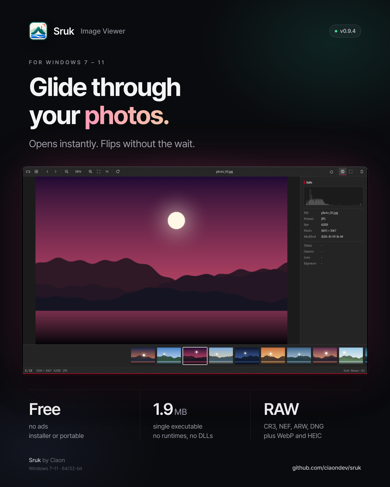 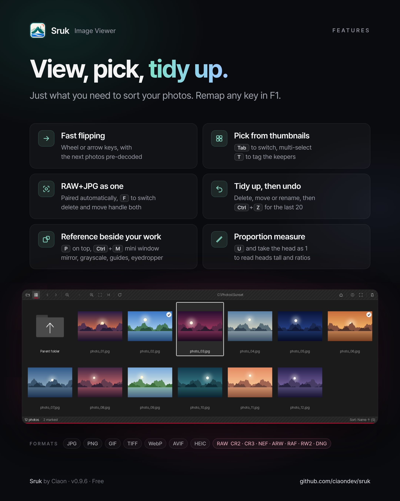

Speed and memory measured side by side with IrfanView (in-house test): see the [benchmark report](benchmark/README.md).

### Features

- **No installation:** a single `sruk.exe` (about 2.1 MB, Windows 7 SP1, 8, 8.1, 10, 11; x64 and x86). No runtimes or DLLs.
- **Fast flipping:** drawn with Direct2D, with the previous and next photos decoded ahead.
- **Formats:** JPG, PNG, BMP, GIF/APNG (animated), TIFF, ICO, camera RAW (CR2, CR3, NEF, ARW, RAF, RW2, DNG and more, via LibRaw).
- **RAW+JPG pairs:** shown as one photo; press F to switch between them. Delete, move and copy handle both files.
- **Culling:** select many thumbnails with Ctrl, Shift or drag; mark with T; Del (Recycle Bin), M (move), C (copy).
- **Info panel:** histogram, file details and shooting info (camera, lens, exposure).
- **Clipboard:** copy the image, the files or the paths (shortcut or right-click).
- **Custom shortcuts:** press F1 to see every shortcut and assign up to three keys per action.
- **Korean / English:** follows the Windows display language; change it with right-click → Language.
- **Update notice:** checks the GitHub releases once a day; Download and install fetches the installer, verifies its SHA-256 and opens it. Turn it off with right-click → Check for updates automatically.

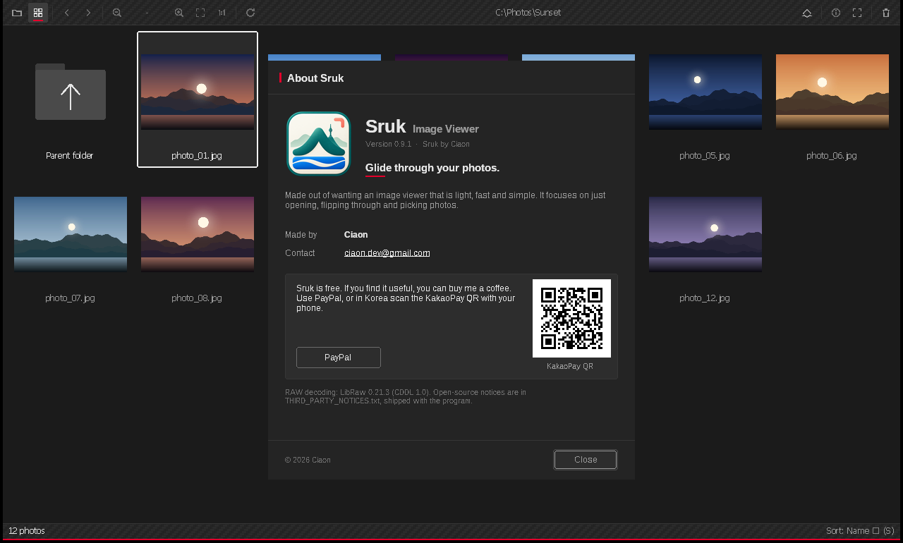

### Reference view and proportion measuring (for sculpting and drawing)

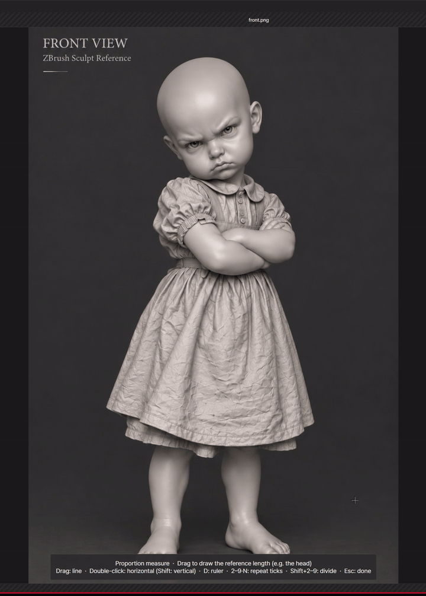 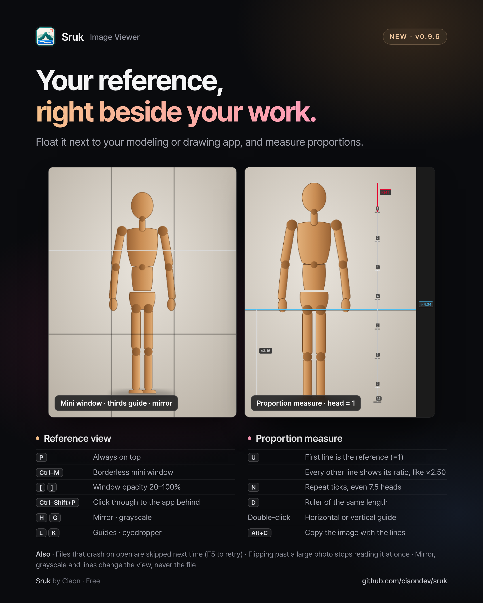

▶ **How-to video (2 min):** https://youtu.be/d2tSrj94jog

- **Proportion measuring (U):** draw a reference line from the top of the head to the chin; its length is 1. Number keys stack head-length ticks to read how many heads tall (N for decimals like 4.5), and other lines show how many references long they are. Double-click for horizontal guides at the eyes, nose and mouth, D for a same-length ruler, Shift+number to divide. Lines are saved per photo; nothing is written to the photo folder.
- **Reference view:** H mirror, G grayscale, L guides (center, thirds, grid), K eyedropper (copies the color code), [ ] opacity, P always on top, Ctrl+M mini window (drag the photo to move it).

### Photo culling (RAW+JPG)

▶ **Photo culling video:** https://youtu.be/lWXvpnWAelc

- RAW and JPG files with the same name show as one photo (F switches between them).
- I shows the histogram and shooting info (camera, lens, exposure) while you choose.
- T marks rejects; Shift+T shows only the marked photos.
- One Del sends RAW and JPG to the Recycle Bin together, and Ctrl+Z brings them all back.

Shorts: [How many heads tall](https://youtube.com/shorts/Oo_VIPic9Co) · [Face proportions](https://youtube.com/shorts/3dWYRR7JI2k) · [4 reference keys](https://youtube.com/shorts/_1-sGfZVMSI) · [Cull RAW+JPG](https://youtube.com/shorts/cmSZJX6BgFM) · All videos and source files: [media](media/README.md)

### Download

Download **`Sruk-Setup-<version>.exe`** from [Releases](../../releases) and run it.
- Installs for the current user without admin rights (`%LOCALAPPDATA%\Programs\Sruk`), adds a Start menu shortcut (desktop optional), and adds Sruk to "Open with" for photo files. It does not change your default apps.
- Uninstall from Windows Settings → Apps → Sruk. Settings in `%APPDATA%\Sruk` are kept.
- The installer picks the 64-bit or 32-bit build to match your Windows.
- Portable: download `Sruk-<version>-portable.zip` (`-portable-32bit.zip` for 32-bit Windows) and run `sruk.exe`.
- The installer is not code-signed, so SmartScreen may warn on first run (More info → Run anyway).

### Contact and donations

- Made by **Ciaon** · ciaon.dev@gmail.com
- Sruk is free. If you find it useful, you can buy me a coffee: [PayPal](https://paypal.me/SupportCiaon) · KakaoPay (Korea: scan the QR above with your phone)

## License

Sruk is free to use and share ([LICENSE.txt](LICENSE.txt)).
It includes [LibRaw](https://www.libraw.org/) 0.21.3 (unmodified, source: https://github.com/LibRaw/LibRaw/tree/0.21.3), used under CDDL-1.0; see [THIRD_PARTY_NOTICES.txt](THIRD_PARTY_NOTICES.txt).
