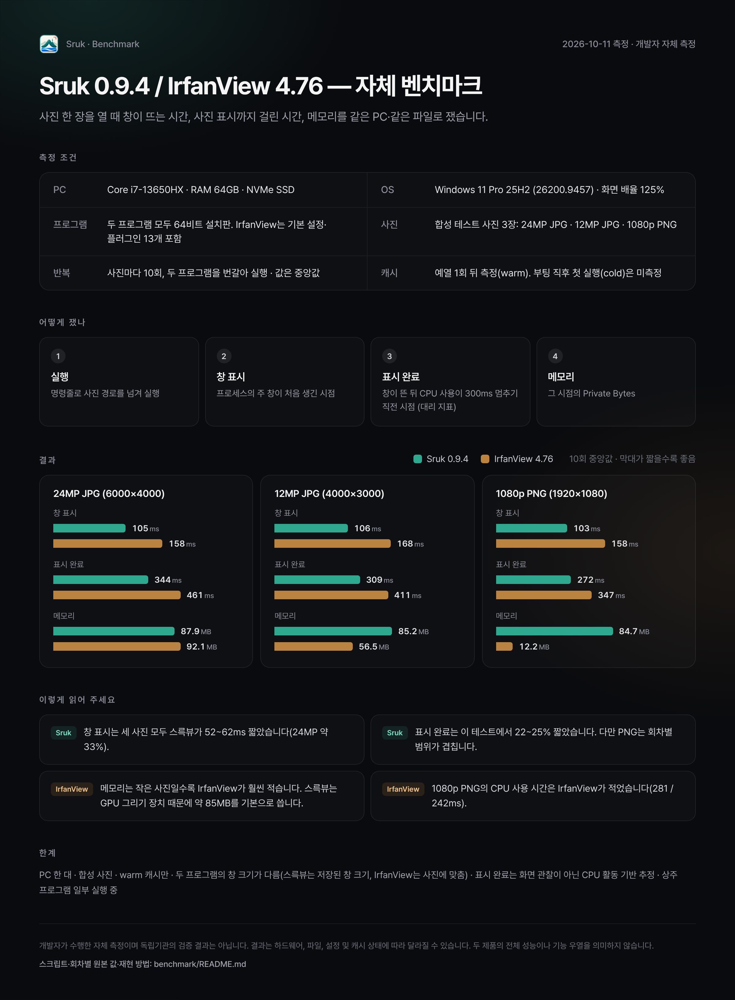

# Sruk 0.9.4 / IrfanView 4.76 — 자체 벤치마크

> 2026-10-11 측정. 개발자가 직접 측정한 결과입니다. 아래 '한계'를 함께 읽어 주세요.

요약 카드: [한국어](card-ko.png) · [English](card-en.png). 수치는 아래 4장 표와 같습니다.

## 1. 목적과 비교 범위

스륵뷰(Sruk)가 사진 한 장을 열 때 얼마나 빨리 창을 띄우고 사진을 보여 주는지, 그때 메모리를 얼마나 쓰는지 같은 PC·같은 파일로 재 본 기록입니다. 다른 프로그램을 깎아내리려는 자료가 아니라, 누구나 조건을 확인하고 다시 재 볼 수 있게 하려는 자료입니다.

비교 대상은 오래 쓰여 온 가벼운 이미지 뷰어인 IrfanView 4.76(64비트)입니다.

이 문서가 다루는 것:
- 사진 파일 하나를 명령줄로 열었을 때의 시작 시간, 사진 표시 완료 시간(대리 지표), 메모리, CPU 사용 시간
- 실행 파일과 프로그램 폴더의 크기(구성 설명 포함)

다루지 않는 것:
- 사진 넘기기, 확대, 썸네일, 편집 등 다른 기능의 속도
- 화질, 지원 형식 수, 기능의 많고 적음
- 다른 PC·다른 Windows 버전에서의 결과

## 2. 환경과 프로그램 설정

| 항목 | 값 |
|---|---|
| 측정일 | 2026-10-11 23:31–23:34 (KST) |
| OS | Windows 11 Pro 64비트, 25H2, 빌드 26200.9457 |
| CPU | Intel Core i7-13650HX (14코어 20스레드) |
| RAM | 64 GB (Windows 표시 63.6 GB) |
| 저장장치 | NVMe SSD (Crucial P3 Plus 2TB, 사진과 두 프로그램 모두 같은 드라이브) |
| GPU | NVIDIA GeForce RTX 4070 Laptop + Intel UHD Graphics. 스륵뷰는 Intel UHD로 그림(Windows 기본 선택, 별도 지정 없음) |
| 화면 배율 | 125% (120 DPI) |
| 전원 관리 옵션 | 균형 조정 |
| 전원 | 어댑터 연결(배터리 아님) |
| 백그라운드 | 쓰지 않는 프로그램을 닫고 PC를 쓰지 않은 상태. 다만 Windows·드라이버·보안 서비스와 일부 상주 프로그램(VPN, 3D 프린터 슬라이서 등)은 실행 중. 측정 직전 5초 동안 전체 CPU 사용 약 13%, CPU 시간을 50ms 이상 쓴 프로세스 33–40개 |

| 프로그램 | Sruk 0.9.4 | IrfanView 4.76 |
|---|---|---|
| 구분 | 64비트 | 64비트 (i_view64.exe, 파일 버전 4.76.0.0) |
| 받은 곳 | github.com/ciaondev/sruk 릴리스 v0.9.4의 설치 파일 | 미확인 (설치 경로와 파일 구성만 확인) |
| 설치 형태 | 설치판 (`%LOCALAPPDATA%\Programs\Sruk`) | 설치판 (`C:\Program Files\IrfanView`) |
| 실행 파일 SHA256 | EFE8C5B0F9D1DE4F4E754AF6D0A88886C7F621D00BA1AE64D0CFE605CCBFE64E | BF6367D4973E8B791580C8117963CA90325437A81D8EBE16DE121CF1D49FC97B |
| 플러그인·언어 | 없음(구조상 플러그인 없음) | 플러그인 13개(Plugins 폴더), 독일어 언어 파일 1개. 표시 언어는 영어 |
| 설정 | 저장된 창 크기·위치로 열림, 창에 맞춰 표시, 아래쪽 필름 스트립 켜짐 | 설정 파일에 언어·툴바·창 위치만 저장됨. 표시 방식 등 나머지는 기본값(세부 값 미확인) |
| 측정 중 창 크기 | 1763×1180 (모든 사진 같음) | 사진에 따라 바뀜: 24MP 2352×1688, 12MP 2092×1688, 1080p 1554×996 |

창 크기가 다르다는 점에 주의해 주세요. 스륵뷰는 저장된 창 크기로 열고 사진을 그 안에 맞추며, IrfanView는 사진 크기에 맞춰 창 크기를 정합니다. 그리는 면적이 다르므로 같은 작업을 했다고 볼 수 없습니다.

## 3. 측정 방법

스크립트: [`bench2.ps1`](bench2.ps1) (Windows PowerShell 5.1)

1. 두 프로그램을 각각 한 번씩 먼저 실행해 예열합니다(기록 제외). 이후 모든 측정은 사진 파일과 프로그램이 이미 Windows 파일 캐시에 올라온 상태(warm)입니다. 캐시가 비어 있는 첫 실행(cold)은 재지 않았습니다(관리자 도구 없이 캐시를 비울 방법이 없어서).
2. 회차마다 두 프로그램을 번갈아 실행합니다. 홀수 회차는 Sruk → IrfanView, 짝수 회차는 IrfanView → Sruk. 사진마다 10회차.
3. 실행 명령: `Start-Process <실행 파일> -ArgumentList "<사진 경로>"` (프로그램이 사진을 인수로 받아 엶)
4. 10ms마다 프로세스를 확인해 다음 값을 기록합니다.
   - **창 표시 시간**: `Start-Process` 호출부터 그 프로세스의 주 창 핸들(`Process.MainWindowHandle`)이 처음 생긴 시점까지. 창이 만들어진 시점이며, 화면에 무언가 그려진 시점과는 다를 수 있습니다.
   - **사진 표시 완료(대리 지표)**: 창이 생긴 뒤 프로세스의 CPU 사용 시간이 마지막으로 늘어난 시점. CPU 사용이 300ms 동안 늘지 않으면 일이 끝났다고 보고, 그 직전의 마지막 활동 시점을 기록합니다. 화면에 사진이 실제로 나타난 순간을 직접 잰 값이 아닙니다. 사진을 그린 뒤 하는 다른 일(스륵뷰는 필름 스트립 썸네일 만들기)까지 포함됩니다. 두 프로그램에 같은 기준을 썼습니다.
   - 메모리: 같은 시점의 Private Bytes(전용 커밋), Working Set(작업 집합, 공유 DLL 포함), Peak Working Set(최대 작업 집합)
   - CPU 사용 시간: 같은 시점까지 프로세스가 쓴 CPU 시간 합계
5. 기록 뒤 창을 닫고(`CloseMainWindow`) 0.5초 쉰 다음 다음 실행으로 넘어갑니다.
6. 각 항목의 대표값은 10회의 **중앙값**입니다. 회차 수가 짝수라 가운데 두 값의 평균입니다. 최소·최대도 함께 적습니다.

참고 지표: 스륵뷰는 자체 로그(`%TEMP%\sruk_perf.log`)에 첫 사진을 화면에 그린 시각을 남깁니다(`FIRST_IMAGE_PRESENTED`, 프로세스 생성 기준). 실제 그린 시점에 가장 가까운 값이지만, IrfanView에는 같은 기록이 없어 비교표에는 넣지 않고 참고로만 적습니다.

## 4. 전체 결과

테스트 사진(합성 이미지, 만드는 방법은 6장):

| 파일 | 해상도 | 크기 | SHA256 |
|---|---|---|---|
| photo-24mp.jpg | 6000×4000 | 9,697,741 바이트 | 149F126C8FA838B746D09130238E1405F8C773BBDD5C0B163BA8935C0A831977 |
| photo-12mp.jpg | 4000×3000 | 4,972,468 바이트 | 7458CA6F41D347786AD51AB770D7369DC1E3EC7A04F2E01FAA07074254FDF8AE |
| screen-1080p.png | 1920×1080 | 5,889,863 바이트 | D8407E7B40BE643A950DF3B8242CEDFE98375038F9069340B533B5D337F607D4 |

### 시간 (ms, 10회 중앙값, 괄호는 최소–최대)

| 사진 | 항목 | Sruk 0.9.4 | IrfanView 4.76 |
|---|---|---:|---:|
| 24MP JPG | 창 표시 | 105 (96–136) | 158 (151–198) |
| | 사진 표시 완료(대리) | 344 (309–482) | 461 (436–578) |
| | CPU 사용 시간 | 453 | 453 |
| 12MP JPG | 창 표시 | 106 (99–136) | 168 (152–190) |
| | 사진 표시 완료(대리) | 309 (274–566) | 411 (380–473) |
| | CPU 사용 시간 | 336 | 344 |
| 1080p PNG | 창 표시 | 103 (96–106) | 158 (149–166) |
| | 사진 표시 완료(대리) | 272 (256–410) | 347 (280–435) |
| | CPU 사용 시간 | 281 | 242 |

스륵뷰 자체 기록(첫 사진을 그린 시각, 프로세스 생성 기준, 중앙값): 24MP 240ms, 12MP 252ms, 1080p 235ms.

### 메모리 (MB = 2^20 바이트, 10회 중앙값)

| 사진 | 항목 | Sruk 0.9.4 | IrfanView 4.76 |
|---|---|---:|---:|
| 24MP JPG | Private Bytes | 87.9 | 92.1 |
| | Working Set | 107.3 | 111.0 |
| | Peak Working Set | 113.4 | 111.2 |
| 12MP JPG | Private Bytes | 85.2 | 56.5 |
| | Working Set | 103.9 | 75.0 |
| | Peak Working Set | 104.7 | 75.1 |
| 1080p PNG | Private Bytes | 84.7 | 12.2 |
| | Working Set | 103.6 | 31.0 |
| | Peak Working Set | 104.8 | 31.0 |

### 크기

| 항목 | Sruk 0.9.4 | IrfanView 4.76 |
|---|---:|---:|
| 실행 파일 | 2,023,424 바이트 (1.93 MB) | 2,558,104 바이트 (2.44 MB) |
| 설치 폴더 전체 | 6,606,787 바이트 (6.30 MB) | 8,849,887 바이트 (8.44 MB) |
| 설치 폴더 구성 | 실행 파일 1.93 MB, 제거 프로그램(Inno Setup) 4.31 MB, 라이선스·안내 문서 | 실행 파일 2.44 MB, 플러그인 13개 5.16 MB, 도움말(chm) 0.28 MB, 언어·툴바·안내 문서, 제거 프로그램 0.14 MB |
| 포터블 배포본 폴더 | 2,047,104 바이트 (1.95 MB, 실행 파일 + 라이선스·안내 문서) | 미측정 |

폴더 크기는 무엇을 함께 넣었는지에 따라 달라집니다. IrfanView 폴더에는 스륵뷰에 없는 기능(효과, 그리기, 슬라이드쇼, 동영상 등 플러그인)이 들어 있습니다. 크기 차이를 효율의 차이로 해석하지 마세요.

회차별 원본 값: [`results/`](results/) 폴더의 `runs-*.csv`(회차·실행 순서·창 크기 포함), 요약은 `summary-*.csv`, 환경은 `env-*-public.txt`.

## 5. 결과 해석

- **창 표시**: 이 테스트 환경에서 세 사진 모두 스륵뷰의 중앙값이 약 52–62ms 짧았습니다. 예를 들어 24MP JPG는 105ms 대 158ms로, 이 테스트에서 약 33% 짧았습니다. 회차별 범위도 겹치지 않았습니다.
- **사진 표시 완료(대리 지표)**:
  - 24MP JPG는 중앙값 344ms 대 461ms로, 이 테스트에서 스륵뷰가 약 25% 짧았습니다.
  - 12MP JPG는 309ms 대 411ms로, 이 테스트에서 약 25% 짧았습니다.
  - 1080p PNG는 272ms 대 347ms로, 이 테스트에서 약 22% 짧았습니다. 다만 회차별 범위가 겹칩니다(256–410ms 대 280–435ms).
  - 두 프로그램의 창 크기가 달랐고, 이 지표는 사진을 그린 뒤의 작업까지 포함합니다(2장, 3장 참고).
- **메모리**:
  - 24MP JPG에서는 Private Bytes 87.9MB 대 92.1MB, Working Set 107.3MB 대 111.0MB로 비슷했습니다. 최대 Working Set은 스륵뷰가 약간 높았습니다(113.4MB 대 111.2MB).
  - 사진이 작을수록 IrfanView가 훨씬 적게 썼습니다. 12MP JPG에서 Private Bytes는 85.2MB 대 56.5MB, 1080p PNG에서는 84.7MB 대 12.2MB입니다.
  - 스륵뷰는 사진 크기와 상관없이 약 85MB를 기본으로 씁니다. 그중 상당 부분은 Direct2D(GPU) 그리기 장치를 만드는 비용입니다(사진 없이 빈 창만 띄워도 약 57MB). IrfanView는 GDI로 그려서 이 비용이 없습니다.
- **CPU 사용 시간**: 24MP와 12MP JPG에서는 비슷했고(453ms 대 453ms, 336ms 대 344ms), 1080p PNG에서는 IrfanView가 적었습니다(281ms 대 242ms).

## 6. 한계와 재현 방법

한계
- 한 대의 PC에서 한 사람이 잰 결과입니다. 다른 하드웨어, 특히 외장 그래픽만 있는 PC, 저사양 PC, HDD에서는 결과가 달라질 수 있습니다.
- 백그라운드를 줄였지만 완전히 통제하지는 않았습니다(Windows 서비스, 보안 프로그램, 일부 상주 프로그램 실행 중). 같은 날 브라우저 등을 켜 둔 채 잰 측정(아래 '이전 측정 기록')에서는 두 프로그램 모두 시간이 조금 길었습니다(항목에 따라 약 1–11%).
- 파일 캐시가 준비된 상태(warm)만 쟀습니다. 컴퓨터를 켠 뒤 처음 여는 경우(cold)는 미측정입니다.
- 사진 표시 완료 시간은 화면을 직접 관찰한 값이 아니라 CPU 활동으로 추정한 값입니다. 측정 간격(10ms)과 Windows CPU 시간 해상도(약 15.6ms) 만큼의 오차가 있습니다.
- 두 프로그램의 창 크기와 표시 배율이 같지 않았습니다.
- 테스트 사진은 합성 이미지입니다. 실제 카메라 사진(EXIF 회전, 다른 압축 방식)에서는 결과가 다를 수 있습니다.
- IrfanView는 설정 대부분이 기본값이고 플러그인이 설치된 상태입니다. IrfanView 설정을 바꾸면 결과가 달라질 수 있습니다.
- 각 10회로, 통계적 유의성 검정은 하지 않았습니다.

재현 방법
1. 테스트 사진 만들기: [`make-test-images.ps1`](make-test-images.ps1)을 `powershell -ExecutionPolicy Bypass -File make-test-images.ps1 24`로 실행하면 `img\` 폴더에 세 파일이 생깁니다. 난수 시드가 고정돼 있지만, Windows 버전에 따라 JPEG·PNG 인코더 출력이 달라질 수 있습니다. 위 SHA256과 비교해 보세요.
2. 프로그램 받기:
   - Sruk: https://github.com/ciaondev/sruk/releases/tag/v0.9.4
   - IrfanView: https://www.irfanview.com/ (64비트 4.76, 같은 결과를 원하면 플러그인 포함)
3. 측정: `powershell -ExecutionPolicy Bypass -File bench2.ps1 -Image img\photo-24mp.jpg -Runs 10`
   - 경로가 기본과 다르면 `-Sruk`, `-Irfan`으로 지정합니다.
   - 실행 중에는 두 프로그램 창이 번갈아 열리고 닫힙니다. 사진 한 장에 약 1분 걸립니다.
   - 결과는 `results\`에 `env-*.txt`, `runs-*.csv`, `summary-*.csv`로 저장됩니다. `env-*.txt`에는 실행 중인 프로세스 이름이 들어가니 공개할 때 확인하세요.
4. 중앙값: 프로그램별 10개 값을 정렬해 5번째와 6번째 값의 평균을 냅니다.

이전 측정 기록 (참고)
- 같은 날 21:35에 같은 스크립트와 같은 공개 0.9.4로, 브라우저·메신저 등을 켜 둔 일반 사용 상태에서 잰 기록이 있습니다. 24MP JPG 중앙값은 창 표시 117 / 174ms, 사진 표시 완료 353 / 482ms였습니다. 원본 값은 [`results/previous-20261011-2135/`](results/previous-20261011-2135/)에 있습니다.
- 같은 날 19:53에 0.9.4 공개 직전 포터블 빌드로 잰 기록이 있습니다(24MP, 앱마다 6회 중앙값). 창 표시 106 / 152ms, 사진 표시 완료 321 / 461ms, Private Bytes 88.0 / 92.0MB, 최대 Working Set 113.5 / 111.0MB.
- 이 기록은 요약값만 남아 있고 회차별 원본 값이 없습니다. 측정한 빌드도 공개본과 다릅니다(휴지통 되살리기 수정 전, 사진 표시 코드는 같음). 그래서 위 결과표에는 쓰지 않았습니다.

---

개발자가 수행한 자체 측정이며 독립기관의 검증 결과는 아닙니다. 결과는 하드웨어, 파일, 설정 및 캐시 상태에 따라 달라질 수 있습니다. 두 제품의 전체 성능이나 기능 우열을 의미하지 않습니다.
